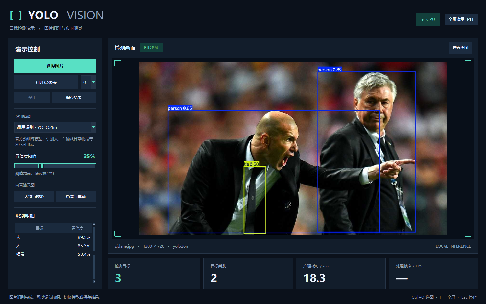
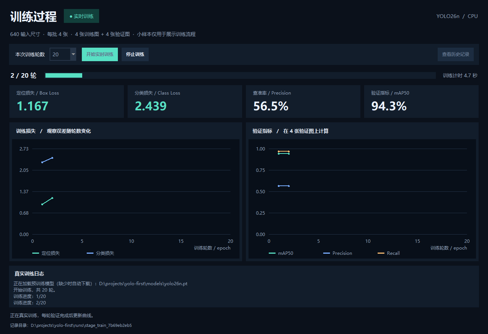
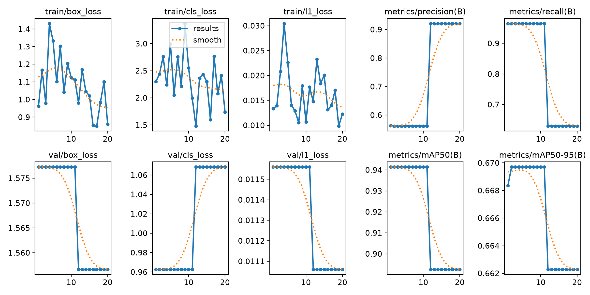
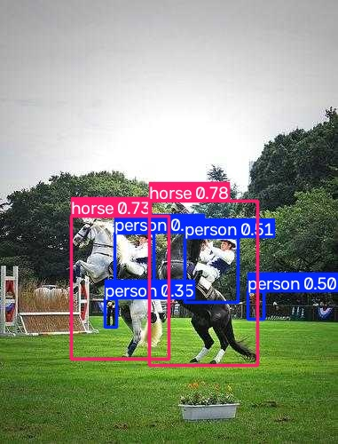

# YOLO Vision · 目标检测演示

本机窗口支持图片识别、摄像头实时识别、模型切换和结果保存，同时保留 YOLO26n + COCO8 的完整训练流程。

训练部分使用的 COCO8 只有 4 张训练图片和 4 张验证图片，用于检查训练流程，不能据此判断真实场景中的识别效果。窗口默认使用官方通用预训练模型。

## 上台演示：打开窗口

环境已安装时，双击根目录的 **启动演示.bat**，或在 PyCharm 中运行 `demo.py`。也可以在项目根目录执行：

```text
.\.venv\Scripts\python.exe -X utf8 demo.py
```

窗口启动后自动识别内置图片，摄像头由“打开摄像头”按钮开启。程序自动使用可用的 NVIDIA GPU，否则使用 CPU，右上角显示实际设备。



- **选择图片**：支持 JPG、PNG、BMP、WebP 及中文路径。
- **摄像头**：默认编号 0，可切换为 1 或 2；打开期间也可点停止取消。首帧超时会回收连接并尝试备用驱动；停止、切换图片或退出会释放相机。
- **置信度阈值**：调高后筛选更严格，图片自动重新识别，摄像头应用到后续帧。
- **模型切换**：默认是官方通用预训练模型；本机存在训练权重时，可切换到最近的 `best.pt`。
- **查看原图**：对比原图与检测框；实时演示保留该选择。
- **保存结果**：保存所选时刻的标注图片和同名 JSON 检测明细。
- **F11**：切换全屏；**Esc**：退出全屏，或在普通窗口中停止摄像头。
- **训练过程**：打开独立窗口，实时显示轮数、损失曲线、验证指标及日志，也可查看历史记录。

内置示例和本机已有权重支持离线演示。首次在新电脑运行时，通用权重缺少则需要联网下载。现场流程见 [演示说明.md](演示说明.md)。

桌面版只保留一个窗口，重复启动会唤起已有窗口，避免多个实例争用相机。

## 实时展示训练过程

打开主窗口右上角的“训练过程”，选择 5、10 或 20 轮，点击“开始实时训练”。也可在首次启动时直接打开训练窗口：

```text
.\.venv\Scripts\python.exe -X utf8 demo.py --training
```



训练会启动新的独立进程，并暂停本演示窗口的摄像头。每轮验证后读取实际写入的 `results.csv`，更新定位损失、分类损失、Precision、Recall 和 mAP50；日志来自训练进程的真实输出。

“查看历史记录”显示已保存的数据，明确标记为历史记录，优先选择完成训练的记录。停止训练会保留已写入的曲线与日志，中断记录仍显示原计划轮数。新结果位于 `runs/stage_train_*/`，不会覆盖旧结果。

这是 COCO8 小样本流程演示，验证指标只来自 4 张图片，不代表实际部署精度。上台快速演示可选择 5 轮；训练窗口也支持 F11 全屏。

“推理耗时”是模型报告的网络推理时间；“处理帧率”是实时模式下单帧采集、检测、标注及编码的处理速度，数值会波动，图片模式显示横线。

## 首次安装与训练

在项目根目录打开 CMD、PowerShell 或 PyCharm 终端。首次安装：

```text
python -m venv .venv
.\.venv\Scripts\python.exe -m pip install -r requirements.txt
```

环境已安装时直接运行：

```text
.\.venv\Scripts\python.exe -X utf8 check_env.py
.\.venv\Scripts\python.exe -X utf8 train.py
```

训练默认使用第一个 NVIDIA GPU，运行 20 轮，然后用保存的最佳权重预测 4 张验证图片。首次运行会自动下载缺少的官方权重和数据。当前依赖针对 Windows、Python 3.13 和 CUDA 12.8；安装 PyTorch 需要下载较大的安装包。

## 独立预测

已经训练过时，可以直接用已有权重识别图片：

```text
.\.venv\Scripts\python.exe -X utf8 predict.py --weights runs/first_train/weights/best.pt --source datasets/coco8/images/val
```

将 `--source` 改为自己的图片或图片文件夹路径即可。相对路径以项目根目录为基准，也可传绝对路径。重复训练会生成 `first_train-2` 等新目录；使用新模型时，将 `--weights` 改为本次训练输出的权重路径。

## 调整参数

默认参数保存在 [config/training.yaml](config/training.yaml)。可以编辑配置，也可以只覆盖某次运行：

```text
.\.venv\Scripts\python.exe -X utf8 train.py --epochs 5 --name demo
.\.venv\Scripts\python.exe -X utf8 train.py --device cpu --skip-preview
```

`--skip-preview` 只执行训练。加 `--verbose` 可以显示第三方日志和错误堆栈。

| 参数 | 默认值 | 含义 |
| --- | --- | --- |
| epochs | 20 | 训练轮数 |
| imgsz | 640 | 输入图片的目标尺寸 |
| batch | 4 | 每批处理的图片数 |
| device | 0 | 第一个 NVIDIA GPU；也可指定 cpu |
| workers | 0 | 在主进程加载数据，适合 Windows 入门 |
| seed | 0 | 固定随机种子，便于比较结果 |

统一入口提供相同的命令：

```text
.\.venv\Scripts\python.exe -X utf8 main.py check
.\.venv\Scripts\python.exe -X utf8 main.py train
.\.venv\Scripts\python.exe -X utf8 main.py predict --weights runs/first_train/weights/best.pt --source datasets/coco8/images/val
```

## 代码组织

```text
yolo-first/
├── main.py                 模块组装：连接界面、事件与后端服务
├── demo.py                 本机窗口演示的组装入口
├── 启动演示.bat             双击启动窗口
├── train.py                保留训练入口
├── check_env.py            保留环境检查入口
├── predict.py              独立预测入口
├── config/                 数据集配置、训练参数
├── common/                 共享数据、事件接口、中文类别名
├── frontend/               命令行界面
│   └── desktop/            识别与训练窗口、样式、事件收件箱
├── backend/
│   ├── application.py      协调检查、训练和预测流程
│   ├── runtime/            路径、配置读取、环境与日志适配
│   ├── data/               数据准备与本机配置生成
│   ├── training/           训练、真实记录读取与实时监控
│   ├── inference/          已有权重的图片推理
│   └── demo/               演示模型、摄像头、推理与结果保存
├── demo_assets/            离线示例和窗口图标
├── tests/                  结构与调用边界回归检查
├── examples/               首次训练的展示结果
├── logs/                   工程记录
└── licenses/               第三方许可文本
```

每个目录都有简短 README，自编 Python 文件顶部有职责注释。入口只负责组装或转交命令，训练流程由后端协调，各项计算由独立服务完成。

前端包含命令行界面和 Tk 本机窗口，只组织交互、订阅事件和渲染结果，不导入后端或计算库。后端不导入前端，通过共享事件接口推送进度与结果。

桌面模式在后台线程加载模型、识别和读取摄像头。事件收件箱只保留最新的检测帧，Tk 主线程定时消费，避免直接跨线程操作控件及画面排队。各服务和前端通过共享接口连接，入口负责模块组装。

导入项目模块不会创建目录、修改环境变量或加载计算库。环境初始化在用户执行计算命令时才发生。YOLO 网络与训练算法由 Ultralytics、PyTorch 提供。

## 在 PyCharm 中运行

1. 打开本项目文件夹，选择 `.venv\Scripts\python.exe` 作为解释器。
2. 上台展示时，右键运行 `demo.py`，窗口打开后即可操作。
3. 需要训练时，先运行 `check_env.py`，检查 `gpu_available` 和显卡名称。
4. 右键运行 `train.py`，按控制台给出的路径查看权重、曲线和预测结果。
5. 需要从终端预测时，运行上面的 `predict.py` 命令；也可在 PyCharm 的运行配置里填写脚本参数。

## 运行结果的位置

| 路径 | 内容 |
| --- | --- |
| models/yolo26n.pt | 官方预训练模型 |
| datasets/coco8/ | 图片及标注 |
| runs/first_train/weights/best.pt | 验证表现最佳的权重 |
| runs/first_train/weights/last.pt | 最后一轮的权重 |
| runs/first_train/results.csv | 逐轮训练指标 |
| runs/first_train/results.png | 训练曲线 |
| runs/preview/ | 训练结束后的图片预测 |
| runs/prediction/ | 独立预测结果 |
| .ultralytics/ | 当前项目的本机配置 |
| logs/environment.json | 环境检查报告 |

重复运行会创建带编号的新结果目录。数据集、本机配置、权重、虚拟环境和完整运行结果由 `.gitignore` 排除，GitHub 保存代码、配置、说明和精选示例。

## 训练结果展示

以下保留的是首次 20 轮训练的结果，后续运行不会自动覆盖这些示例。





逐轮指标见 [examples/results.csv](examples/results.csv)。示例图片来自官方 COCO8 验证集。

## 验证

```text
.\.venv\Scripts\python.exe -X utf8 -m unittest discover -s tests -v
```

检查导入副作用、前后端依赖边界、事件订阅、输出转发、独立预测、参数校验、实时帧背压、后台异常恢复及相机异常释放。实际训练和窗口演示的验证记录见 [logs/progress.md](logs/progress.md)。

## AI 协助与参考

环境安装、代码、说明、训练运行和工程整改由 Codex 协助完成。可以按“界面输入 → 模块组装 → 后端协调 → 环境与数据 → 训练或推理 → 事件通知 → 界面展示”的顺序阅读代码。

- [Ultralytics 训练说明](https://docs.ultralytics.com/modes/train/)
- [Ultralytics 回调说明](https://docs.ultralytics.com/usage/callbacks/)
- [COCO8 数据集说明](https://docs.ultralytics.com/datasets/detect/coco8/)
- [PyTorch 安装版本](https://pytorch.org/get-started/previous-versions/)

`config/coco8.yaml` 改编自 Ultralytics 的配置，保留其 AGPL-3.0 许可说明，许可文本见 [licenses/ultralytics-AGPL-3.0.txt](licenses/ultralytics-AGPL-3.0.txt)。
